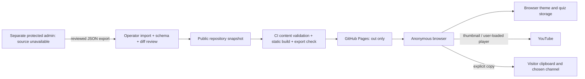

# NEST LMS pre-launch audit

Audit date: 6 October 2026 (Asia/Colombo). Target: this checkout at `D:\NEST club ( NSBM )\nest-lms`, HEAD `9b3482689fc4395af52d3315073c5161aa38c352`, including current working-tree content. This is the initial audit, not the post-remediation report.

## Executive summary

| Measure | Result |
| --- | --- |
| Critical | **0** |
| High | **0** |
| Medium | **5** |
| Low | **8** |
| Informational | **3** |
| Security status | No confirmed exploitable public-site vulnerability identified in reviewed application source. Dependency warnings and provider controls require follow-up. Protected admin security cannot be assessed from this checkout. |
| Performance status | Local mobile lab LCP approximately 1.95–2.52 seconds; CLS 0 in sampled runs. INP and field performance unmeasured. |
| Accessibility status | Important defects: measured light-theme contrast failures, footer target sizes, continuous scrolling without a pause control; invalid About ARIA label. No WCAG conformance claim. |
| SEO status | Titles/descriptions and social image exist; no sitemap/robots file; most pages lack canonical URLs; metadata origin is hardcoded. |
| Deployment status | Clean install/build/export passes at root and the GitHub project prefix. `npm start` fails for the configured static export. Provider settings and live release unverified. |
| Overall production readiness | Public learning site needs focused reliability/accessibility/privacy fixes and launch verification. Full protected LMS/admin readiness remains unassessed. |

**NOT READY — IMPORTANT ISSUES MUST BE FIXED**

The principal reproducible functional defect is checkpoint completion failing when localStorage writes are unavailable. Five medium findings concern reliability, accessibility and privacy—not confirmed remote compromise. The npm scanner separately reports **9 high and 1 critical affected packages**, which are not the severity counts above. Static Pages does not execute the vulnerable Next.js server features identified by those critical advisories.

No application fixes, dependency upgrades, commits, pushes, deployment, production-database access or third-party mutations were performed. Only this report/audit artifacts and normal generated build/test outputs were created. Existing modifications to the public content snapshot and visual test file were preserved.

## 1. Architecture and scope

| Aspect | Detected implementation |
| --- | --- |
| Frontend/build | Next.js **16.3.0** App Router, React/React DOM **19.2.8**, TypeScript, Tailwind CSS 4; npm package-lock v3. |
| Public backend/API | None in the deployed artifact. `next.config.ts:5` sets `output: "export"`, trailing slashes and optional `PAGES_BASE_PATH`; images are unoptimized. No route handlers, Server Actions or middleware found in public app. |
| Data/storage | Static TypeScript data plus reviewed `data/generated/admin-content.json`; public filesystem assets. Browser theme/checkpoint state in localStorage. No public ORM/database. |
| Authentication/authorization | No public login/accounts/roles. Every exported lesson is public. Checkpoint answers/results are not credentials; changing own storage does not bypass server authorization. |
| Protected administration | Design documents describe SSO/OIDC + allowlist, relational DB, audit history, media storage and one admin role. Current ignored `admin/` contains residual local env/build/database state, **no auditable implementation/package/routes/migrations**. These documented controls are not verified. |
| Integrations | YouTube player at `youtube-nocookie.com` activated on demand; thumbnails from `i.ytimg.com` before activation. YouTube/WhatsApp/course-provider links. No payment, SMTP, webhook or scheduled job implementation. |
| Publishing | Operator imports approved admin JSON, validates schema, reviews diff, commits/releases. Import validates before temporary-file rename. Public build repeats validation. Research is currently a News migration page, not a protected library. |
| Hosting/CI | `.github/workflows/deploy-pages.yml`: main push/manual dispatch → Node 22/npm ci → content/build/export check → upload **only out/** → GitHub Pages deployment. |
| Environment | Public app consumes `PAGES_BASE_PATH`; example site/admin URL variables are not effective metadata controls. Origin hardcoded at `app/layout.tsx:18`. Server env example values empty. |

Public routes: `/`, `/about/`, `/announcements/`, `/community/`, `/contact/` (client redirect to About), `/courses/`, three `/courses/[slug]/` pages, 85 lesson pages, 15 checkpoint pages, `/news/`, three story pages, `/research/`, and generated 404 output. Build/export checker counts **117 HTML files** (including framework/error output) and **172 local targets**.



Trust boundaries and attacker stories:

* A visitor controls enquiry fields and their own storage. JSX/textareas escape enquiry data; submit prepares text locally. No network, database or HTML-execution sink was found.
* An operator-selected import crosses into public content. Recursive field allowlists, unique slug rules, zero-progress rules and destination validation operate before replacement. Human approval/provenance is procedural; importer does not authenticate the source. A person already trusted to publish outbound links gains no new privilege by selecting an external HTTP(S) destination.
* Repository/main and deployment rights control public integrity. Branch protections/environment approvals are provider facts, not inferable from YAML.
* Video URLs are reduced to an 11-character ID and reconstructed at fixed HTTPS hosts. No backend URL fetch exists: no established SSRF path.
* Future admin identity/database/media boundaries require a separate source/runtime audit. Public Pages must never be treated as implementing them.

## 2. Checks and measured evidence

| Check | Outcome |
| --- | --- |
| `npm run check` in current checkout | **PASS**: ESLint, route generation, TypeScript, 5/5 content tests, production build, static export check. |
| Clean install | **PASS**: isolated temporary directory populated from HEAD plus current tracked source and the existing extra portrait asset; no copied node_modules/.next/out/env. `npm ci --no-audit --no-fund`, then full `npm run check`. This tests the current tree, not a pristine HEAD-only clone. |
| Install policy | 361 packages installed; host blocked unrs-resolver postinstall under its script policy; checks still passed. Local Node **24.16.0**; CI Node **22**/Linux not executed here. |
| Project-prefix build | **PASS** in isolated copy: `PAGES_BASE_PATH=/NEST-Lms-NSBM-`, build + export check. Source unchanged. This is asset/link verification, not a hosted-browser test of provider RSC/fallback behavior. |
| `npm start -- --hostname 127.0.0.1 --port 4188` | **FAIL**: Next reports `next start` incompatible with `output: export`; process exited. |
| Complete existing Chromium Playwright suite | **133 passed / 20 failed / 153 total**, 5.8 minutes. All failures are screenshot comparisons. All 78 existing route/theme/viewport layout checks passed, plus normal quiz, publishing, navigation, clipboard fallback, video mock and gallery checks. |
| Additional responsive checks | **140 checks**, 10 routes × 2 themes × widths 320/375/430/768/1024/1440/1920; no horizontal overflow observed. Not proof of every clipping/landscape/zoom/state combination. |
| axe-core WCAG tags | 20 route/theme runs at 390px. 47 light-theme contrast node failures; shared footer has 3 undersized links; About invalid ARIA in both themes. Repeated nodes are grouped into shared findings. Incomplete checks remain manual work. |
| Exceptional browser state | Forced `Storage.prototype.setItem` failure; final checkpoint answer triggers uncaught `Storage blocked`, stays on question, result panel absent in both themes. |
| Dependency audit | `npm audit --json`: 10 affected packages, 9 high/1 critical. Advisory reachability assessment below; no upgrades. |
| Lockfile inspection | 443 package entries including root; all resolved downloads use registry.npmjs.org and have integrity fields. Install-script flags: fsevents/unrs-resolver. This does not prove every package is benign or maintained. |
| Secrets | Pattern searches across current public source/config, tracked env/key paths, exported structure and history changes: no confirmed exposed secret. Ignored local admin env contains development access code and AUTH_SECRET; values never printed. History URL positives occurred in tests/deployment examples; exhaustive entropy/history scanning was not done. |
| Browsers | Chromium available and exercised; Firefox/WebKit binaries unavailable. Safari/iOS/Firefox and real-device accessibility remain manual release gates. |

Evidence files: `artifacts/prelaunch-audit/browser-results.json`, reproducible audit script `artifacts/prelaunch-audit/browser-audit.cjs`, `artifacts/prelaunch-audit/npm-audit.json`, blocked-storage screenshots, and existing `playwright-report/index.html`/`test-results/` traces and snapshot diffs. The extra browser audit used the loopback production export while the main suite was running; contention and machine/cache variability limit performance precision.

### Performance lab

Chromium 390×844, fresh contexts, 4× CPU slowdown, 150ms latency, 200,000 bytes/sec download, 93,750 bytes/sec upload. Nine runs, 6.5-second observation after navigation; no Lighthouse installation. This is a small CDP/PerformanceObserver lab assessment, not a Lighthouse score or field CWV certification.

| Route | LCP runs (s) | Median LCP | CLS |
| --- | --- | --- | --- |
| Home | 2.484 / 2.444 / 2.448 | 2.448s | 0 / 0 / 0 |
| Courses | 1.948 / 2.524 / 2.408 | 2.408s | 0 / 0 / 0 |
| About | 2.424 / 2.360 / 2.356 | 2.360s | 0 / 0 / 0 |

Objectives: LCP ≤2.5s, INP ≤200ms, CLS ≤0.1. One Courses run exceeded LCP objective; headroom is small. INP **not measured**. Need real-user p75 after launch. The local server sends no-store and no compression, unlike a possible production CDN. Resource byte counts are local encoded bytes, not predicted CDN transfer.

Export total: **18,284,077 bytes**; all JS files combined **732,106 bytes**, approximately **227,205 bytes gzip** (not all loaded by one page). First sampled Home/Courses/About loads transferred approximately 1.11/1.07/0.96MB, with script bodies approximately 537/542/481KB. Largest image 276KB; WebP assets and self-hosted font output are already used. Static imported images also have public originals, causing duplicate artifact bytes; duplication is not necessarily duplicate browser transfer. `unoptimized` means no runtime image service/responsive optimizer—consider pre-generated responsive variants if field measurements warrant them. No expensive DB queries, API storms or shared-runtime memory leaks apply to this deployment; cleanup exists for observers and animation callbacks in inspected components.

## 3. Findings

Counts include functional, privacy, accessibility, configuration and maintenance observations. Classification is explicit; unknown host controls and scanner warnings are not confirmed application vulnerabilities.

### AUD-01 — Checkpoint cannot finish when browser storage writes fail

**ID:** AUD-01 · **Severity:** MEDIUM · **Category:** Reliability / exceptional conditions · **Classification:** Confirmed localhost functional defect.

**Location/file:** `components/module-quiz.tsx:99-115`. **Affected component:** All checkpoint result/completion writes.

**Evidence:** Read helpers catch failures, but `advance()` calls localStorage.setItem without a catch before setPhase("results"). Forced storage rejection in both themes produced a pageerror and zero `.quiz-results` panels after the last answer.

**Why it matters:** Optional persistence should not prevent completion. **Likely impact:** Lost visible result/progress when storage is denied or quota exhausted; user remains on final question. **How encountered:** Restrictive storage policy, unavailable browser storage, full quota.

**Recommended fix:** Complete the in-memory result transition regardless of persistence; guard both writes, validate stored result shape, and explain when results could not be saved. **Difficulty:** Low. **Breaking-change risk:** Low. **Verify:** Test successful result display with read/write SecurityError and QuotaExceededError, malformed stored shapes, pass/fail/retry/reload flows.

### AUD-02 — Light-theme small text fails contrast

**ID:** AUD-02 · **Severity:** MEDIUM · **Category:** Accessibility, WCAG 1.4.3 · **Classification:** Measured automated defect with source corroboration.

**Location/file:** `app/globals.css:14,101`; shared eyebrow/text-link styles and affected course/video/mentor text. **Affected component:** All ten sampled light-theme routes.

**Evidence:** 47 failing nodes; examples `#4d8ef7` over `#f7fbff` at **3.09:1**, mentor label **3.18:1**, About section labels **3.04:1**; small text requires 4.5:1. Examples/selectors recorded in browser-results.json. Dark theme had no confirmed contrast violations in these samples; incomplete gradient/translucent checks remain.

**Why it matters:** Text is harder to read for low-vision users. **Likely impact:** Reduced readability/navigation. **How encountered:** Default/light theme links, labels and gallery controls.

**Recommended fix:** Separate text accent colors from decorative/background tokens; darken affected text while checking buttons, hover, focus and all themes. **Difficulty:** Low–medium. **Breaking-change risk:** Low (visual). **Verify:** Rerun axe and manually measure transparent/gradient/image backgrounds in all interactive states.

### AUD-03 — Shared footer targets fail minimum size/spacing

**ID:** AUD-03 · **Severity:** MEDIUM · **Category:** Accessibility, WCAG 2.5.8 · **Classification:** Automated measured defect; exceptions require manual confirmation.

**Location/file:** `components/site-footer.tsx:37-39`; `app/globals.css:101`. **Affected component:** Contact/community/YouTube footer links, eight shared-layout routes in both themes.

**Evidence:** Dimensions **70.6×21**, **167.3×21**, **185.6×23px**; axe safe-circle diameters 21/21/23px below 24px. Repeated failures represent three shared controls, not dozens of separate bugs.

**Why it matters:** Harder touch selection and adjacent-link activation. **Likely impact:** Mobile usability barriers. **How encountered:** Tapping footer contact links.

**Recommended fix:** Provide ≥24×24px target area and sufficient separation; aim larger where layout permits. **Difficulty:** Low. **Breaking-change risk:** Low (footer spacing). **Verify:** Axe target-size, real touch testing and manual check of any WCAG exception.

### AUD-04 — Continuous text marquees have no pause control

**ID:** AUD-04 · **Severity:** MEDIUM · **Category:** Accessibility, WCAG 2.2.2 · **Classification:** Source-supported accessibility defect.

**Location/file:** `app/page.tsx:61-83`; `app/globals.css:998-1007,1421-1425`. **Affected component:** Two home learning/technology strips.

**Evidence:** 40s/46s infinite automatic animations; no pause/stop/hide mechanism. Duplicate copies aria-hidden. Reduced-motion OS preference suppresses animation, which helps but does not supply an ordinary page control.

**Why it matters:** Nonessential movement continues past five seconds beside other content. **Likely impact:** Reading/distraction barrier. **How encountered:** Home under normal motion preference.

**Recommended fix:** Add accessible pause/resume for scrolling content or use static strips; retain reduced-motion handling. **Difficulty:** Low–medium. **Breaking-change risk:** Low (visual interaction). **Verify:** Keyboard/screen-reader control, persistent paused state while reading, and existing motion tests adjusted only after approved behavior review.

### AUD-05 — Privacy disclosure and public-photo approval need completion

**ID:** AUD-05 · **Severity:** MEDIUM · **Category:** Privacy / publication governance · **Classification:** Missing public notice confirmed; media approval/legal adequacy unverified.

**Location/file:** `components/lesson-video.tsx:24-35`; `components/module-quiz.tsx:27-28,109-112`; `data/event-highlights.ts:17-31`; `docs/photo-assets.md`; shared footer.

**Affected component:** Video pages, local progress, portraits and school event galleries.

**Evidence:** Browser requests `i.ytimg.com` before loading player; provider receives network metadata. No dedicated privacy route/link found. Form explains browser-only preparation, but no consolidated storage/provider/deletion notice. Photo documentation calls portraits edited previews for review before publication; school galleries include Grade 6 activities. No consent record was established by this code audit.

**Why it matters:** Users need truthful data handling information and publication owners need media approval. **Likely impact:** Surprise third-party requests/shared-device progress retention and publication complaints. **How encountered:** Visiting video facade, using quizzes, appearing in a public gallery.

**Recommended fix:** Draft accurate notice for hosting logs, theme/progress storage, thumbnail/player requests, clipboard and voluntary external sharing; describe clearing local data and provide contact/deletion process. Consider click-to-load thumbnails. Have the club verify photo rights/identity accuracy and required guardian/institution approvals where applicable; do not invent approval or identities. **Difficulty:** Medium (content/owner review). **Breaking-change risk:** Low; thumbnail behavior may change. **Verify:** Pre/post-activation network inspection, storage inventory, published notice, documented owner review. Jurisdiction-specific legal review is separate; no GDPR/CCPA/local-law compliance claim.

### AUD-06 — Dependency warnings require a controlled patch review

**ID:** AUD-06 · **Severity:** LOW for this static public deployment · **Category:** Supply chain · **Classification:** Tool warning; no evidenced visitor exploit path.

**Location/file:** `package.json:20-34`, `package-lock.json`; npm-audit.json. **Affected component:** Next/sharp and build/lint/parser tooling.

**Evidence:** Nine high/one critical affected packages. Next 16.3.0 matches server/optimizer/next-og advisories; public artifact does not run those features. **Why it matters:** Dependencies remain vulnerable under other execution modes and should not be carried into a server deployment unreviewed. **Likely impact:** Conditional build/development/server risk, not established public RCE. **How encountered:** Changing deployment to a Next Windows server or adding an affected parser/image-generation input path.

**Recommended fix:** Evaluate maintained compatible patched Next/eslint releases and transitive updates; review advisory paths and lock diff, then rebuild/test. Do not accept npm's suggested major downgrade or run audit fix blindly. Keep development loopback-only. **Difficulty:** Medium. **Breaking-change risk:** Medium. **Verify:** Fresh npm ci/audit, source reachability and full gates. Reassess protected admin separately before runtime exposure.

### AUD-07 — Advertised start script fails for static hosting

**ID:** AUD-07 · **Severity:** LOW · **Category:** Deployment configuration · **Classification:** Confirmed local command incompatibility.

**Location/file:** `package.json:13`; `next.config.ts:5`. **Affected component:** Operator/server-hosting startup.

**Evidence:** npm start exits with Next's output-export incompatibility error. Pages workflow is unaffected because it uploads files. **Why it matters:** Generic Node hosting can deploy a build then fail startup. **Likely impact:** Outage if wrong host/start command selected. **How encountered:** Hosting template assumes npm start.

**Recommended fix:** Document static build/output contract and provide an explicit local static preview command; do not convert to server architecture just to satisfy start. **Difficulty:** Low. **Breaking-change risk:** Low. **Verify:** Start documented preview; check root/deep paths/assets/404 and project prefix on intended host.

### AUD-08 — Canonical/discovery metadata is incomplete

**ID:** AUD-08 · **Severity:** LOW · **Category:** SEO · **Classification:** Confirmed source/output omissions; domain mismatch conditional on migration.

**Location/file:** `app/layout.tsx:17-45`; no app robots/sitemap modules or exported files; route metadata. **Affected component:** Public search/social URLs.

**Evidence:** Ten sampled primary routes have unique titles/descriptions and one h1; no canonical links. Contact supplies About canonical. No robots.txt/sitemap.xml. Social image resolves to hardcoded GitHub project URL, regardless of NEXT_PUBLIC_SITE_URL.

**Why it matters:** Harder URL consolidation/discovery and wrong social domain after migration. **Likely impact:** Search quality/preview inconsistency, not guaranteed deindexing. **How encountered:** Crawlers or social sharing after domain change.

**Recommended fix:** Centralize validated public origin/base path; route canonicals and sitemap; deliberate robots policy; preserve private exclusion if future admin exists. Resolve retired Contact/Research URLs with host redirects or explicit canonical/noindex policy. **Difficulty:** Low–medium. **Breaking-change risk:** Low–medium (prefix handling). **Verify:** Inspect all exported metadata, sitemap URLs, social images, 404/noindex behavior and actual host redirects. No need to make private routes indexable.

### AUD-09 — Host security/transport policy has no verified evidence

**ID:** AUD-09 · **Severity:** LOW · **Category:** Security configuration · **Classification:** Verification gap / defense-in-depth, not confirmed missing live headers.

**Location/file:** `.github/workflows/deploy-pages.yml`; `next.config.ts`; exported artifact. **Affected component:** Hosting boundary.

**Evidence:** No repository header/redirect policy; live provider response not inspected. Next headers cannot be assumed to configure static Pages. **Why it matters:** TLS/redirect/frame/referrer policies depend on provider. **Likely impact:** Conditional downgrade/framing/privacy risk. **How encountered:** Host configuration differs from assumptions.

**Recommended fix:** Verify HTTPS/redirects, HSTS, nosniff, framing, CSP and Referrer/Permissions policies at intended origin. Apply only host-supported policy after a report-only test; CSP compatibility proposal below. **Difficulty:** Medium (provider dependent). **Breaking-change risk:** Medium for CSP. **Verify:** Header readback on root/deep/404 assets and browser journeys with no CSP errors; assess policy on intended host, not test server.

### AUD-10 — Visual suite lacks an approved passing baseline

**ID:** AUD-10 · **Severity:** LOW · **Category:** Release quality · **Classification:** Confirmed test failures; regression attribution partly manual.

**Location/file:** `tests/visual.spec.ts:145-155`; `tests/visual.spec.ts-snapshots/`; `test-results/`. **Affected component:** Twenty desktop/mobile comparisons.

**Evidence:** 133 pass/20 fail. Announcements baseline 1440×1927 vs current 1440×2958 reflects gallery/content expansion; mobile Courses diff includes theme-toggle/footer differences. Actual Announcements and Courses diff visually inspected; no horizontal break established. **Why it matters:** Failing references reduce regression signal. **Likely impact:** Undetected future visual regressions. **How encountered:** Existing complete suite.

**Recommended fix:** Review each failed actual/diff against intended design; repair actual regressions, then deliberately approve/update only intended baselines. Do not automatically accept all diffs. **Difficulty:** Medium. **Breaking-change risk:** Low if review accurate. **Verify:** Entire suite passes with reviewed images; screenshots are not accessibility tests.

### AUD-11 — Primary community path and leadership content are unfinished

**ID:** AUD-11 · **Severity:** LOW · **Category:** Critical journey/content readiness · **Classification:** Confirmed content gaps; QR validity unverified.

**Location/file:** `data/community.ts:5`; `app/community/page.tsx:29`; `app/about/page.tsx:24`; `data/team.ts:11-22`. **Affected component:** Join community / leadership.

**Evidence:** WhatsApp invite is empty; tap link omitted, QR only. Master-in-Charge renders "Lecturer name"; team names/roles explicitly pending. Portrait order does not imply position. **Why it matters:** Same-device mobile users need actionable contact; public institutional identity should be approved. **Likely impact:** Abandoned joining or misleading incomplete information. **How encountered:** Community/About.

**Recommended fix:** User supplies/validates official current invite and approved identities/roles; retain honest placeholder wording until confirmed, or omit unfinished profiles. **Difficulty:** Low after owner inputs. **Breaking-change risk:** Low. **Verify:** Real owned-device QR/tap journey, official group destination and content sign-off; do not join/post automatically.

### AUD-12 — About placeholder has invalid ARIA naming

**ID:** AUD-12 · **Severity:** LOW · **Category:** Accessibility/semantics · **Classification:** Confirmed axe defect.

**Location/file:** `app/about/page.tsx:24`. **Affected component:** `.profile-photo--mentor`.

**Evidence:** aria-label on generic div without naming-permitted role flagged in both themes. **Why it matters:** Label may be ignored by assistive tech. **Likely impact:** Unclear placeholder semantics. **How encountered:** Screen-reader navigation of mentor block.

**Recommended fix:** Use suitable image semantics/text or remove unnecessary naming; decorative icon can remain hidden. **Difficulty:** Low. **Breaking-change risk:** Low. **Verify:** Axe and screen-reader output. Generic named hero/filter blocks had incomplete axe results, not additional confirmed failures.

### AUD-13 — CI does not run all available release checks

**ID:** AUD-13 · **Severity:** LOW · **Category:** Maintainability/supply-chain hardening · **Classification:** Confirmed gate omission, not exploit.

**Location/file:** `.github/workflows/deploy-pages.yml:21-48`; `package.json:12`. **Affected component:** Release build.

**Evidence:** Workflow installs, builds and checks export, but omits explicit lint/content tests/browser suite. Action tags mutable; top-level Pages write/OIDC permissions also available to build job. No hostile PR trigger/interpolation found. **Why it matters:** Regressions can deploy despite tests that would fail locally. **Likely impact:** Broken releases and excess CI authority if separately compromised. **How encountered:** Main/manual deployment.

**Recommended fix:** Add coherent lint/type/content gates and suitable browser gates after baseline review; scope deploy-only permissions, pin actions to reviewed commits with an update process, verify branch/environment protections. **Difficulty:** Medium. **Breaking-change risk:** Low–medium (gate can block release). **Verify:** Owned CI run from reviewed revision, permission separation and intentional failing-test gate check. Do not publish during audit.

### AUD-14 — Protected admin production readiness is outside available source

**ID:** AUD-14 · **Severity:** INFORMATIONAL · **Category:** Scope limitation · **Classification:** Confirmed missing implementation evidence.

**Location/file:** `admin/`, `.gitignore:30-31`, `docs/ADMIN_PLATFORM_ARCHITECTURE.md`, `docs/CONTENT_PUBLISHING.md:10-14`. **Affected component:** Admin auth, session lifecycle, roles, database/media/export.

**Evidence:** Ignored residual state only; documented separate checkout, no current admin code. **Why it matters:** Documentation cannot prove guards/cookies/transactions/backups. **Likely impact:** Unknown protected-system risk. **How encountered:** Attempting to approve admin/full LMS based on public audit.

**Recommended fix:** Separate audit of actual admin source and owned localhost/staging; verify auth/session revoke/reset where implemented, allowlist/IDOR/mutations/CSRF/upload/DB limits and recovery. **Difficulty:** Medium–high audit effort. **Breaking-change risk:** Unknown until source reviewed. **Verify:** Evidence-backed authenticated/unauthenticated/removed-admin scenarios with test DB. No protected launch approval from this report.

### AUD-15 — Operational monitoring/recovery ownership is unverified

**ID:** AUD-15 · **Severity:** INFORMATIONAL · **Category:** Observability/backups · **Classification:** Readiness evidence gap.

**Location/file:** `docs/CONTENT_PUBLISHING.md:32-35`; deployment workflow; README. **Affected component:** Releases, media and future DB.

**Evidence:** Content rollback documented as revert/check/release; no verified restore drill, uptime/error alerting, recovery targets or credentials-rotation owner. Public repository/static artifact can be rebuilt; browser progress has no server backup. **Why it matters:** Recovery needs tested ownership. **Likely impact:** Longer incident recovery, user-local data loss on clear/device change. **How encountered:** Broken release, account compromise, lost content/media.

**Recommended fix:** Define owner, protected repository/media backup and known-good revision/host rollback drill; uptime probes for home/course/deep link, sanitized client-error capture if appropriate. For admin separately require encrypted DB backups, restore test, migrations rollback/forward recovery and SSO/DB/session rotation procedure. **Difficulty:** Medium. **Breaking-change risk:** Low unless new telemetry collects unnecessary data. **Verify:** Controlled restore/rollback and alert test without production writes; never log tokens/contact data/local quiz payloads.

### AUD-16 — Field performance and cross-browser/manual access remain unverified

**ID:** AUD-16 · **Severity:** INFORMATIONAL · **Category:** Performance/browser compatibility/coverage · **Classification:** Measurement gap, not proven failure.

**Location/file:** `playwright.config.ts:25-31`; `artifacts/prelaunch-audit/browser-results.json`; `next.config.ts:8-10`. **Affected component:** Real devices, visitors and CDN.

**Evidence:** Chromium only; small lab LCP margin; INP unmeasured. Existing WCAG automated tags cannot prove conformance. **Why it matters:** Safari, device CPUs, caching and accessibility behavior differ. **Likely impact:** Unknown field usability/performance. **How encountered:** Real mobile, keyboard/screen reader, 200%/400% zoom, landscape, older supported browser.

**Recommended fix:** Manual Safari/iOS/Firefox and real-device checks; zoom/reflow/focus/reading order/quiz announcements. Add field CWV only with privacy review, then optimize actual bottlenecks. A skip-to-main link would improve keyboard use; semantic landmarks already provide some bypass mechanisms, so absence alone is not a confirmed WCAG failure. **Difficulty:** Medium. **Breaking-change risk:** Low for verification. **Verify:** Record devices/versions and p75 LCP/INP/CLS when sufficient real-user samples exist.

## 4. Security framework coverage

References checked: [OWASP Top 10:2025](https://owasp.org/Top10/2025/) and [ASVS 5.0.0 stable release](https://github.com/OWASP/ASVS/releases/tag/v5.0.0_release). This is control-oriented assessment, not ASVS certification. ASVS validation/encoding, web frontend, file handling, configuration, data protection and logging are applicable; public authentication/session/OAuth/API controls are not applicable to the static artifact. They remain required for separately deployed protected services.

| OWASP 2025 area | Disposition |
| --- | --- |
| A01 Broken Access Control | No public privileged operations/tenant objects. Client checkpoint manipulation affects own untrusted presentation only. Admin guards/IDOR unverified due absent source. |
| A02 Security Misconfiguration | Host header/TLS settings unverified (AUD-09); incompatible start command AUD-07. No public dev/admin routes exported. |
| A03 Software Supply Chain Failures | Lockfile integrity/npm ci present; warnings reviewed below; CI hardening AUD-13. No package replacement based on age alone. |
| A04 Cryptographic Failures | No public password/session/token implementation. HTTPS destinations used in render helpers; transport verified only as code intent, not provider behavior. Ignored local secrets not public evidence. |
| A05 Injection | React encoding, constant theme script, finite slug validation, fixed video URLs; no SQL/command/template/LDAP/NoSQL sink. Import URL policy inspected. |
| A06 Insecure Design | Honest local enquiry/quiz model; privacy/media process AUD-05. Protected design cannot establish implementation safety. |
| A07 Authentication Failures | No public login/reset/registration/recovery surface. All admin auth flows unassessed; no fabricated password-strength or session claims. |
| A08 Software or Data Integrity Failures | Strict import shape + atomic replacement + build check; human review controls publication. Local results not verified credential data. Provider branch controls unknown. |
| A09 Security Logging and Alerting Failures | Static artifact has no backend event log; alerting/recovery ownership AUD-15. No observed application credential logging. |
| A10 Mishandling of Exceptional Conditions | Confirmed storage write failure AUD-01. Import invalid-data tests preserve prior snapshot. Clipboard failure handled. Local test-server URL decoding can crash preview; non-production informational maintenance. |

Cookie flags, JWT algorithms/issuer/audience/revocation, password hashing/reset, CSRF, CORS for sensitive APIs, server request size/rate limits, database parameterization/transactions/foreign keys, uploads, payments, SMTP/webhooks and background jobs: **not applicable to actual public static implementation**, rather than claimed passes. No dynamic search/contact/email/upload endpoint to brute force or exhaust; catalogue search is local over 85 lessons. Static-host traffic abuse protection is provider-owned. Future admin requires endpoint-specific budgets and protections.

### Dependency warning reachability

| Warning | Preconditions and current counterevidence | Disposition |
| --- | --- | --- |
| Next Windows server RCE [GHSA-p293-qw3h-jr36](https://github.com/advisories/GHSA-p293-qw3h-jr36) | Next server on Windows; public CI uploads static files, no such runtime. Development server should remain local. | Not established in published static site; reevaluate runtime deployment. |
| Next AVIF optimizer RCE [GHSA-2xp9-vwfh-vxw4](https://github.com/advisories/GHSA-2xp9-vwfh-vxw4), sharp/libheif | AVIF optimization through affected native stack; `images.unoptimized`, no optimizer/API/uploads here. | No visitor path; local trusted image assets/builds are a different boundary. |
| Next Node ImageResponse RCE [GHSA-vcvr-r3jv-pc5j](https://github.com/advisories/GHSA-vcvr-r3jv-pc5j) | Attacker-controlled SVG values into Node `next/og` ImageResponse; no import/route/sink here, static social WebP. | Non-applicable current path. |
| brace-expansion/braces → micromatch/fast-glob → eslint plugin/config | Crafted parser/glob input during build/lint; no visitor-provided patterns. | Build tooling warning without evidenced public exploit. |
| js-yaml | Crafted YAML consumed by affected parser; no public YAML processing. | Build/tooling warning; review input paths during patching. |
| source-map-js | Crafted indexed map consumed by affected parser; no public map-upload/parser endpoint. | Build tooling warning without current visitor path. |

Patched versions differ by advisory (Next server/optimizer 16.3.3; Node ImageResponse 16.3.6); npm suggested 16.3.8 when queried. Selection needs a compatible release/lock review and validation at fix time. Scanner suggests an eslint-config major downgrade in some transitive paths: do not execute that recommendation blindly.

### Compatible CSP proposal — requires host support and testing

Current pages need same-origin bundles/fonts/images, inline Next initialization scripts and fixed theme script, inline styles/dynamic CSS properties, YouTube thumbnail images and iframe. No external application JavaScript CDN was found, so SRI is not presently required for one; hash-named self-hosted chunks use the deployment integrity boundary. Do not invent nonce support for immutable static HTML.

Start with **Report-Only**, after checking intended host support:

```text
default-src 'self'; script-src 'self' 'unsafe-inline'; style-src 'self' 'unsafe-inline'; img-src 'self' data: https://i.ytimg.com; font-src 'self'; connect-src 'self'; frame-src https://www.youtube-nocookie.com; object-src 'none'; base-uri 'self'; form-action 'self'; frame-ancestors 'none'
```

This intentionally permits required inline script/style and is **not a strong anti-XSS CSP**. A stronger static policy can derive SHA-256 hashes for every actual inline script per export and test host/header limits; the theme script hash alone is insufficient for Next payloads. No `unsafe-eval` usage was established as an application requirement. YouTube iframe internal resource policy belongs to YouTube. `frame-ancestors` requires an HTTP header; meta CSP cannot enforce it. Add upgrade-insecure-requests only after HTTPS deployment verification. Consider Referrer-Policy strict-origin-when-cross-origin, nosniff, a framing policy and narrow Permissions-Policy compatible with clipboard/fullscreen/video. HSTS rollout depends on HTTPS/subdomain ownership; do not blindly include all subdomains/preload. GitHub Pages hosting options must be verified before assuming arbitrary response headers can be configured.

## 5. Coverage across requested phases

| Phase | Result / remaining work |
| --- | --- |
| 1 Architecture | All current public source entry points mapped; independent baseline and architecture review. Admin implementation unavailable. |
| 2 Build/code quality | Current and isolated full gates passed, prefix export passed; start mismatch and screenshot failures recorded. No material public TODO/debug/localhost/env runtime dependency found by search. Custom 404 exists; live 404/status/provider redirects unverified. No global error boundary found; browser input/storage defect prioritized. |
| 3 Secrets/config | Public/example/env/Git filename/history patterns inspected without values. Ignored admin secrets present; no confirmed public exposure. Full historical entropy scan and real provider secret rotation unverified. |
| 4 Security | Source-backed boundaries reviewed; no confirmed exploitable public app finding. Conditional warnings/calibrated controls above. |
| 5 Supply chain | Live npm audit, lock registry/integrity/install scripts and CI examined; no blind upgrade/abandoned-package assertion. |
| 6 HTTP/browser security | Compatible CSP proposal; intended provider readback still needed. Loopback test headers do not demonstrate production headers. |
| 7 Abuse | No dynamic expensive public operations; hosting limits/provider traffic protection needs verification. |
| 8 DB/integrity | Public importer/publishing integrity tested. No public DB. Admin constraints, transactions, privileges, races/backup unverified. |
| 9 Privacy | State/clipboard/external media/photo handling mapped; disclosure/owner approval AUD-05; no compliance claim. |
| 10 Performance | Nine throttled lab samples, resources/bundles/images/fonts assessed. No Lighthouse/field/INP coverage. |
| 11 Responsive | Existing layout checks and 140 added width checks passed; expanded galleries pass. Long arbitrary publisher text, landscape, zoom and every state not exhaustively inspected. |
| 12 Accessibility | Axe findings plus motion source review; keyboard menu/clipboard flows tested. Screen reader/contrast incomplete states/quiz focus transitions manual. |
| 13 SEO | Output metadata/source inspected; origin/canonical/robots/sitemap issues identified. External links/content availability not crawled. |
| 14 Reliability | Invalid import preserves file, clipboard fallback passes, normal quiz passes; blocked storage failure confirmed. No public DB/API failures to simulate. Video tests mock provider: real playback/network outage requires manual check. |
| 15 Observability | No public backend log; monitoring/alert evidence gap. No secrets/contact payloads should be added to logs. |
| 16 Recovery | Manual content revert documented; restore/host rollback drill, repository/media copies and admin DB recovery not verified. |
| 17 Hosting | Build/output/prefix/CI/start verified locally; DNS/TLS/Linux/provider settings and persistent admin storage not verified. |
| 18 Testing | Complete existing suite run; no baselines/tests/source fixes applied. Recommended exceptional-storage/accessibility tests after approval. |
| 19 Tooling | npm audit, TypeScript/ESLint/content/export tests, Chromium/axe and read-only Codex Security source review. No destructive exploit/ZAP scan or third-party attack. |
| 20 Report | This initial report and evidence produced. Await approval before fixes; final full audit/report reserved for approved remediation completion. |

Coverage is substantial for current public application source, not exhaustive security review of every dependency, generated byte or binary asset. Assets/large generated JSON/lockfile were assessed through structure, validation, output and tooling rather than semantic line-by-line content accuracy. No production account/database was contacted; adjacent admin checkout was not opened. Branch/environment protections, consent, real video availability, field telemetry, legal obligations and hosting policy cannot be confirmed locally.

## 6. Prioritized remediation plan

Ordering considers security/data loss/outage/critical journey/privacy first, then performance/accessibility/SEO/quality; priority does not equal vulnerability severity.

| Order | IDs | Action | Recommendation / dependency |
| --- | --- | --- | --- |
| 1 | AUD-14, 09 | Confirm public-only launch boundary, intended static host; obtain separate admin audit and provider TLS/header evidence | Required verification; no public architecture rewrite. |
| 2 | AUD-06, 13 | Controlled dependency patch plan and CI permission/release gate hardening | Implement after advisory/compatibility review, not scanner autofix. |
| 3 | AUD-01 | Make optional storage fail safely; add meaningful exceptional-state tests | **Implement before public launch.** |
| 4 | AUD-07, 10 | Correct static preview/start contract; review twenty image diffs and approve intended references | Implement/document locally; no mass baseline acceptance. |
| 5 | AUD-11 | Verify official tap-to-join URL, QR, leadership content | Requires user/club-owned facts. |
| 6 | AUD-05 | Privacy notice and media/edited-portrait publication review | Draft technical disclosure; owner must resolve media/legal approvals. |
| 7 | AUD-15, 16 | Record rollback/alert/device/field-measurement plan | Verify first; optimize only measured bottlenecks. |
| 8 | AUD-02, 03, 04, 12 | Contrast, target sizes, pause/static motion, ARIA semantics | **Implement before public launch**, preserving design where practical. |
| 9 | AUD-08 | Origin/canonical/sitemap/robots/retired URL policy | Implement once intended public origin is confirmed. |

Suggested approved implementation batches: (A) checkpoint resilience/static preview contract; (B) shared accessibility and motion; (C) origin/SEO and accurate privacy/content with confirmed inputs; (D) carefully reviewed dependency/CI updates and visual reference review. Rebuild and relevant tests after each; full initial checks again afterward. Do not deploy or alter protected databases as part of these local batches.

Manual verification / probable non-applicable warnings: dependency RCEs absent runtime sinks; trusted publisher outbound-link normalization is not privilege escalation; own quiz storage tampering is not IDOR; constant themeScript is not user-input XSS; loopback malformed-percent URL crash is dev-tool availability, not public RCE; `outline:none` search input has alternate focus border/ring; no skip link alone does not establish failure when main/headings exist. Host-header absence, media consent, exact role identities, video availability, browser differences and gradient contrast remain explicitly unresolved.

**Approval boundary:** Per your pasted request, stop here. No fixes have been applied. Approve the desired batches and supply/confirm official origin/community/leadership/media facts before their dependent changes. After approved fixes, rerun the complete audit and create `PRE_LAUNCH_AUDIT_FINAL.md` comparing both results; do not create that final report prematurely.

## Security scan provenance

The Codex Security source review completed and sealed its original snapshot with zero validated security vulnerabilities and explicitly partial coverage. Its zero finding count does not include the functional/accessibility/privacy/readiness observations above.

* [Generated security report](C:/Users/Lenovo/.codex/state/plugins/codex-security/scans/nest-lms/9b3482689fc4395af52d3315073c5161aa38c352_20261006T134513Z__c9n92zn/report.md)
* [Canonical coverage](C:/Users/Lenovo/.codex/state/plugins/codex-security/scans/nest-lms/9b3482689fc4395af52d3315073c5161aa38c352_20261006T134513Z__c9n92zn/coverage.json), [findings](C:/Users/Lenovo/.codex/state/plugins/codex-security/scans/nest-lms/9b3482689fc4395af52d3315073c5161aa38c352_20261006T134513Z__c9n92zn/findings.json), [manifest](C:/Users/Lenovo/.codex/state/plugins/codex-security/scans/nest-lms/9b3482689fc4395af52d3315073c5161aa38c352_20261006T134513Z__c9n92zn/scan-manifest.json)

Finalization warned that working-tree contents changed during the scan. The initial and final Git status show the same pre-existing tracked modifications; this run added the requested report and audit artifacts/generated outputs. No application fixes were applied. Results remain bound to the original source snapshot and are not a later remediation audit.

Tool-reported usage across four scan threads: 5,835,460 total tokens, including 5,471,616 cached input tokens; 38,039 output tokens. This is the plugin's aggregate rollout accounting, not a cost estimate. The preflight continued with three available worker slots despite a nonblocking recommendation for more; source coverage limits are listed explicitly above.
